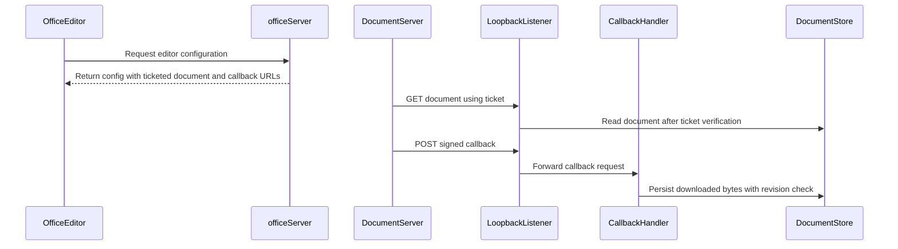

# PR #307 issue comments (fetched 2026-10-23T23:46:47.217Z)

---
## commenter: coderabbitai[bot] | created: 2026-10-23T19:52:38Z
<!-- coderabbit-ai-generated:v1 -->

<!-- This is an auto-generated comment: summarize by coderabbit.ai -->
<!-- review_stack_entry_start -->

<a href="https://app.coderabbit.ai/change-stack/thecodacus/pithagoras/pull/307?scope=ghh_OusAJGA4HG8ljoOV0wJvVx8NmnZIjc2DdjmxOu0xZWA&amp;cs_source=review_comment"><picture><source media="(prefers-color-scheme: dark)" srcset="https://storage.googleapis.com/coderabbit_public_assets/review-stack-in-coderabbit-ui-dark.svg?v=3"><source media="(prefers-color-scheme: light)" srcset="https://storage.googleapis.com/coderabbit_public_assets/review-stack-in-coderabbit-ui.svg?v=3"></picture></a>

<!-- review_stack_entry_end -->
<!-- walkthrough_start -->

<strong>📝 Walkthrough</strong>

<dl>
<dd>

This pull request adds an Office extension for document storage, browser editing through OnlyOffice, chat-scoped document tools, and comment-triggered wake messages. It also adds settings and container lifecycle management, authenticated document and callback routes, OOXML processing, and tests.

**Changes: Office extension**

|Layer / File(s)|Summary|
|:---|:---|
|**Extension package and build setup**   `core/server/test/extension-ui.test.mjs`, `extensions/office/.gitignore`, `extensions/office/README.md`, `extensions/office/build.mjs`, `extensions/office/deps.js`, `extensions/office/package.json`, `extensions/office/scripts/make-fixtures.mjs`, `extensions/office/tsconfig.json`|Adds the Office package manifest, dependency and build scripts, TypeScript configuration, generated-output ignores, fixture-generation script, and extension documentation. The shipped-extension test includes `pithagoras-understory`.|
|**OOXML processing and document library**   `extensions/office/src/ooxml.ts`, `extensions/office/src/store.ts`, `extensions/office/test/fixtures.test.mts`, `extensions/office/test/ooxml.test.mts`, `extensions/office/test/store.test.mts`|Adds ZIP, DOCX, and XLSX parsing and writing; indexed document creation, import, export, trash cleanup, and revision-checked persistence; and tests for these operations.|
|**Settings and Document Server lifecycle**   `extensions/office/src/host.ts`, `extensions/office/src/settings.ts`, `extensions/office/src/container.ts`, `extensions/office/test/container.test.mts`, `extensions/office/test/settings.test.mts`|Adds settings persistence and portal and Docker access. The container module creates or adopts the configured Document Server container, reports its status, and records explicit stop intent.|
|**Editor access, callbacks, and server routes**   `extensions/office/src/jwt.ts`, `extensions/office/src/tickets.ts`, `extensions/office/src/callback.ts`, `extensions/office/src/server.ts`, `extensions/office/test/callback.test.mts`, `extensions/office/test/server.test.mts`, `extensions/office/test/integration.test.mts`|Adds signed editor configuration, ticketed document delivery, verified callbacks, server routes, and server lifecycle handling. Callback persistence checks document revisions before writing downloaded bytes.|
|**Chat tools, live state, and comment wakes**   `extensions/office/src/live.ts`, `extensions/office/src/tools.ts`, `extensions/office/src/ping.ts`, `extensions/office/test/tools.test.mts`, `extensions/office/test/ping.test.mts`, `extensions/office/test/integration.test.mts`|Adds chat-scoped document tools, presence and lock state, co-edit force-save checks, and comment-mention processing that records grants and queues wake messages.|
|**Browser library, editor, and settings**   `extensions/office/src/client.tsx`, `extensions/office/src/portal.tsx`, `extensions/office/src/office-ui.ts`, `extensions/office/src/web/*`, `extensions/office/style.css`, `extensions/office/test/office-ui.test.mts`|Adds Office navigation and chat UI, shared browser state and API calls, a document library and editor page, settings controls, and related styles.|

<!-- change_assessment_start -->
**Priority:** ➖ Normal

**Estimated code review effort:** 5 (Critical) | ~120 minutes

<!-- change_assessment_commit:"fee666ce7b7b846a6d941992d0755f330331c83c" -->
**Change:** Feature
<!-- change_assessment_end -->

### Sequence Diagram(s)

**Possibly related issues**

- [thecodacus/pithagoras#280](https://github.com/thecodacus/pithagoras/issues/280) — The issue proposes the Office extension’s document tools, OnlyOffice integration, comment wakes, callback authentication, and Docker lifecycle. This pull request implements those areas.

**Possibly related PRs**

- [thecodacus/pithagoras#294](https://github.com/thecodacus/pithagoras/pull/294) — This PR changes how remembered server-half tools appear when their package is switched off or uninstalled; the Office extension registers its tools through that portal path.
- [thecodacus/pithagoras#288](https://github.com/thecodacus/pithagoras/pull/288) — This PR adds the server audit contract used by the Office document actions and comment wakes.

**Suggested reviewers:** `thecodacus`

</dd>
</dl>

<!-- walkthrough_end -->

<strong>Merge Risk:</strong> <strong>🟡 Moderate</strong> · up to <code>fee66</code>

<dl>
<dd>

<!-- final_review_risk_start -->
<!-- final_review_risk_label
**Merge Risk:** **🟡 Moderate** · up to `fee66`
-->
<!-- final_review_risk_coverage:{"sourceCommitId":"fee666ce7b7b846a6d941992d0755f330331c83c","coveredCommitId":"fee666ce7b7b846a6d941992d0755f330331c83c","kind":"reviewed"} -->

Large DOCX imports can make the portal temporarily unresponsive. Bound or move import-time parsing before merging.
<!-- final_review_risk_end -->

</dd>
</dl>

<!-- pre_merge_checks_walkthrough_start -->

<strong>Pre-merge checks: <picture></picture> 4 · <picture></picture> 1</strong>

<dl>
<dd>

<strong><picture></picture> Failed checks: 1 warning</strong>

|     Check name     |                                              Status                                              | Explanation                                                                                                                                                                                   | Resolution                                                                         |
| :---------------- | :----------------------------------------------------------------------------------------------: | :-------------------------------------------------------------------------------------------------------------------------------------------------------------------------------------------- | :--------------------------------------------------------------------------------- |
| Docstring Coverage |  | Docstring coverage is 58.18% which is insufficient. The required threshold is 80.00%. Docstring coverage is scoped to functions touched by this diff. Analyzed 440 functions across 71 files. | Write docstrings for the functions missing them to satisfy the coverage threshold. |

<strong><picture></picture> Passed checks: 4 passed</strong>

<dl>
<dd>

|         Check name         |                                             Status                                             | Explanation                                                                                                                                    |
| :------------------------ | :--------------------------------------------------------------------------------------------: | :--------------------------------------------------------------------------------------------------------------------------------------------- |
|      Description Check     |  | Check skipped - CodeRabbit’s high-level summary is enabled.                                                                                    |
|         Title check        |  | The title clearly and concisely identifies the main change: adding an OnlyOffice Document Server extension for Office documents in the portal. |
|     Linked Issues check    |  | Check skipped because no linked issues were found for this pull request.                                                                       |
| Out of Scope Changes check |  | Check skipped because no linked issues were found for this pull request.                                                                       |

</dd>
</dl>

</dd>
</dl>

<!-- pre_merge_checks_walkthrough_end -->
<!-- finishing_touch_checkbox_start -->

<strong>✨ Finishing Touches: 💡 2</strong>

<dl>
<dd>

<!-- finishing_touch_suggestion:docstrings -->

<strong>📝 Generate docstrings: 💡</strong>

<dl>
<dd>

- [ ] <!-- {"checkboxId":"3e1879ae-f29b-4d0d-8e06-d12b7ba33d98"} --> Commit to this branch
- [ ] <!-- {"checkboxId":"7962f53c-55bc-4827-bfbf-6a18da830691"} --> Create a new PR

</dd>
</dl>

<strong>🧪 Generate unit tests (beta)</strong>

<dl>
<dd>

- [ ] <!-- {"checkboxId": "6ba7b810-9dad-11d1-80b4-00c04fd430c8", "radioGroupId": "utg-output-choice-group-unknown_comment_id"} --> Commit to this branch
- [ ] <!-- {"checkboxId": "f47ac10b-58cc-4372-a567-0e02b2c3d479", "radioGroupId": "utg-output-choice-group-unknown_comment_id"} --> Create a new PR

</dd>
</dl>

<!-- finishing_touch_suggestion:fix_ci -->

<strong>🛠️ Fix failing CI checks: 💡</strong>

- [ ] <!-- {"checkboxId": "9f0d24fb-b419-4f01-baf0-8b26b6424f34", "radioGroupId": "fix-ci-output-choice-group-6373469052"} --> Commit to this branch
- [ ] <!-- {"checkboxId": "6d21cfe8-ec3f-40e2-9222-b8318b64d3b0", "radioGroupId": "fix-ci-output-choice-group-6373469052"} --> Create a new PR

</dd>
</dl>

<!-- finishing_touch_checkbox_end -->

<!-- autopilot:start -->
- [ ] <!-- {"checkboxId":"2708ad07-9f24-4260-9c11-7dc76a49f2e3"} --> <strong title="Keep fixing CodeRabbit findings and required CI, and resolving merge conflicts">Autofix</strong> · Keep fixing CodeRabbit findings and required CI, and resolving merge conflicts
<!-- autopilot:end -->
<!-- tips_start -->

Thanks for using [CodeRabbit](https://coderabbit.ai?utm_source=oss&utm_medium=github&utm_campaign=thecodacus/pithagoras&utm_content=307)! It's free for OSS, and your support helps us grow. If you like it, consider giving us a shout-out.

<strong>❤️ Share</strong>

<dl>
<dd>

- [X](https://twitter.com/intent/tweet?text=I%20just%20used%20%40coderabbitai%20for%20my%20code%20review%2C%20and%20it%27s%20fantastic%21%20It%27s%20free%20for%20OSS%20and%20offers%20a%20free%20trial%20for%20the%20proprietary%20code.%20Check%20it%20out%3A&url=https%3A//coderabbit.ai)
- [Mastodon](https://mastodon.social/share?text=I%20just%20used%20%40coderabbitai%20for%20my%20code%20review%2C%20and%20it%27s%20fantastic%21%20It%27s%20free%20for%20OSS%20and%20offers%20a%20free%20trial%20for%20the%20proprietary%20code.%20Check%20it%20out%3A%20https%3A%2F%2Fcoderabbit.ai)
- [Reddit](https://www.reddit.com/submit?title=Great%20tool%20for%20code%20review%20-%20CodeRabbit&text=I%20just%20used%20CodeRabbit%20for%20my%20code%20review%2C%20and%20it%27s%20fantastic%21%20It%27s%20free%20for%20OSS%20and%20offers%20a%20free%20trial%20for%20proprietary%20code.%20Check%20it%20out%3A%20https%3A//coderabbit.ai)
- [LinkedIn](https://www.linkedin.com/sharing/share-offsite/?url=https%3A%2F%2Fcoderabbit.ai&mini=true&title=Great%20tool%20for%20code%20review%20-%20CodeRabbit&summary=I%20just%20used%20CodeRabbit%20for%20my%20code%20review%2C%20and%20it%27s%20fantastic%21%20It%27s%20free%20for%20OSS%20and%20offers%20a%20free%20trial%20for%20proprietary%20code)

</dd>
</dl>

Comment `@coderabbitai help` to get the list of available commands.

<!-- tips_end -->

---
## commenter: Piggidragon | created: 2026-10-23T21:50:05Z
Addressed all 13 review comments in d6a62fdf (replied on each).

On the earlier CI failure of this branch (run 40014812580): the server job failed one assertion — the portal's shipped-extensions list now includes `pithagoras-office`, which `core/server/test/extension-ui.test.mjs` did not expect. Fixed in the same commit: the package moved to `extensions/office`, following the folder convention of its siblings, and the test's expected list names it.

One note for maintainers: locally on a machine with an ambient `ALLOW_OPEN=1` (and portal credentials) in the environment, `core/server/test/auth-streams.test.mjs` fails one case because the harness spreads the parent environment into every test server; with a clean environment everything passes.

---
## commenter: Piggidragon | created: 2026-10-23T22:35:32Z
Round-2 review — all five findings addressed in aae4892:

- callback.ts: JWT verified exactly once per request; the result is reused for the signed-envelope binding (no more expiry window between two verifications).
- ooxml readZip: 1 GiB archive-level cap on the combined advertised expansion, enforced in the central-directory loop before any entry is retained — many just-under-the-256-MiB-limit entries can no longer stack up to multi-gigabyte decompression (per-entry cap kept as a second layer).
- ping first-save rule: provenance now decides. An imported document (DocMeta.imported, stamped by importFile) baselines its pre-existing comment history without wakes; a created blank document has no baseline, so a mention written in the first editing session wakes the owner on that first save.
- office_read: docx details bounded independently of the 200k-char text cap (100 comments x 500 chars + exact commentCount), since details land in the tool-event store/web transcript unbounded by MAX_READ_CHARS.
- **Out-of-diff finding (tools.ts, forcesave-first hook): now fail-closed.** The hook resolves true only when a force-save is actually confirmed. In v1 a browser-side save cannot be confirmed from the server, so makeForcesaveHook returns false while any session is open (recording an audit line that says exactly that) and office_edit refuses with error:session_open — it no longer proceeds on an unconfirmed state. Once the hook is unavailable or unconfirmed, nothing is written and the revision gate is re-checked only after a confirmed flush.

Suite: 123 tests, 0 failures (3 docker-gated skips); tsc clean.
